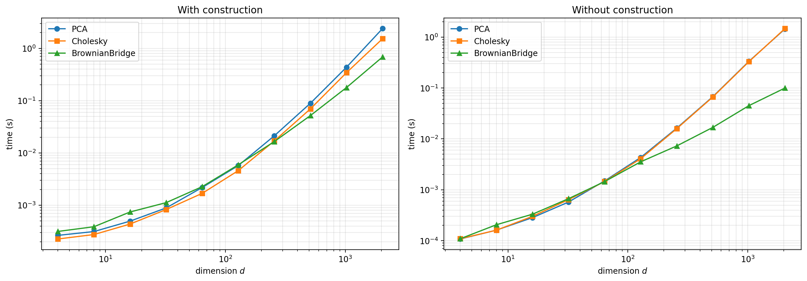
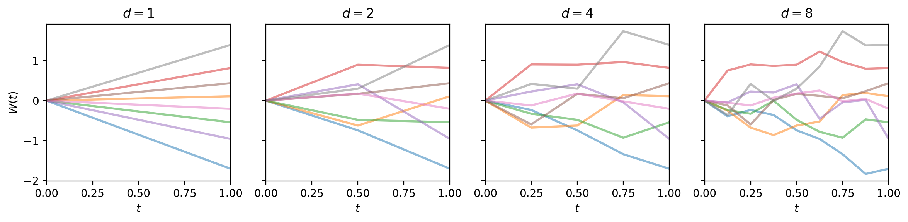

This post introduces `BrownianBridge` as a third `decomp_type` option for the `BrownianMotion` class.

::: {.callout-note}
The examples require QMCPy 2.4 or later. The option-pricing example also uses pandas:

```bash
pip install --upgrade "qmcpy>=2.4" pandas
```

The runtimes shown below are empirical benchmark results and vary by machine and software environment. They are not theoretical performance guarantees.
:::

## Introduction

The `BrownianMotion` class turns low discrepancy points into Brownian motion paths. The path values have covariance $\Sigma_{ij} = \min(t_i, t_j)$, so for the decomposition options `PCA` and `Cholesky`, generating a path of $d$ times means computing a $d \times d$ matrix $A$ satisfying $AA^\top = \Sigma$. This matrix $A$ is then multiplied by standard normal values to produce the final Brownian motion path. Computing $A$ costs $O(d^3)$ once, and the multiplication costs $O(d^2)$ for every path.

The new option, `BrownianBridge`, produces paths with the same covariance without factoring $\Sigma$. By default, it samples the final time first and then works inwards, sampling each remaining time conditional on the two nearest times already sampled. This follows Algorithms 6.1 and 6.2 of Owen [1]. This has two main benefits. Since the values with the largest conditional variance are paired with the highest quality points of the low discrepancy sequence, it is possible to lower the effective dimension [2]. A path also only costs $O(d)$ to generate since each new value is built conditional on solely the two nearest points.

More comprehensive examples can be viewed in the [Brownian bridge demo](https://qmcsoftware.org/qmcpy/demos/brownian_bridge/). The executable source is the [Brownian bridge demo notebook](https://github.com/QMCSoftware/qmcpy/blob/master/demos/brownian_bridge.ipynb) in the QMCPy repository.

## The Bridge Construction

Given a Brownian motion $W$ with $W(0) = 0$, the conditional distribution of an interior value given its two surrounding points $\ell$ and $r$ is [1, 4]

<div class="overflow-auto" tabindex="0" role="region" aria-label="Conditional Brownian motion distribution">

$$W(s) \;\Big|\; W(\ell),\, W(r) \;\sim\; \mathcal{N}\left(W(\ell) + \frac{s - \ell}{r - \ell}\big(W(r) - W(\ell)\big),\, \frac{(s - \ell)(r - s)}{r - \ell}\right).$$

</div>

Rearranging, the result is

<div class="overflow-auto" tabindex="0" role="region" aria-label="Brownian bridge construction formula">

$$W(s_j) = a_j\,W(\ell_j) + b_j\,W(r_j) + w_j\,Z_j,$$

</div>

where $Z_1, \ldots, Z_d$ are independent standard normals and the coefficients depend on which neighbors exist when $s_j$ is sampled. Owen's Algorithm 6.1 computes the neighbor indices and coefficients once, then Algorithm 6.2 builds the path. There are four cases, represented in the table below (Owen, equations 6.10 and 6.11 and algorithms 6.1 and 6.2 [1]).

<div class="overflow-auto" tabindex="0" role="region" aria-label="Brownian bridge coefficients">

| case | $a_j$ | $b_j$ | $w_j$ |
|------|-------|-------|-------|
| first point, no neighbor | $0$ | $0$ | $\sqrt{s_j}$ |
| left neighbor only | $1$ | $0$ | $\sqrt{s_j - \ell_j}$ |
| right neighbor only | $0$ | $s_j / r_j$ | $\sqrt{s_j (r_j - s_j) / r_j}$ |
| both neighbors | $\dfrac{r_j - s_j}{r_j - \ell_j}$ | $\dfrac{s_j - \ell_j}{r_j - \ell_j}$ | $\sqrt{\dfrac{(s_j - \ell_j)(r_j - s_j)}{r_j - \ell_j}}$ |

</div>

Owen's algorithm ensures that every case is accounted for regardless of the sampling order. However, the left only case occurs when $s_j$ exists beyond every time sampled so far, which the default ordering never produces since the final time is sampled first.

## The O(d) Time Complexity

`BrownianBridge` also produces a factorization in the same sense that `PCA` and `Cholesky` do, though the resulting matrix is different. For $d = 4$, in construction order,

$$W(1) = Z_1$$

$$W(\tfrac12) = \tfrac12 Z_1 + \tfrac12 Z_2$$

$$W(\tfrac34) = \tfrac34 Z_1 + \tfrac14 Z_2 + \sqrt{\tfrac18}\, Z_3$$

$$W(\tfrac14) = \tfrac14 Z_1 + \tfrac14 Z_2 + \sqrt{\tfrac18}\, Z_4$$

Reading off the coefficients gives matrix $A$, where $A_{ij}$ is the coefficient of $Z_j$, and this matrix $A$ satisfies $AA^\top = \Sigma$ [3]. Furthermore, each step $j$ of construction corresponds with a matrix $M_j$, and the full construction multiplies them in sequence, $A = M_d \cdots M_1$. These matrices are very sparse, since each one is simply the identity matrix with only row $j$ altered. For instance, for $W(\frac34)$,

$$ M_3 = \begin{pmatrix} 1 & 0 & 0 & 0 \\ 0 & 1 & 0 & 0 \\ \frac12 & \frac12 & \sqrt{\tfrac18} & 0 \\ 0 & 0 & 0 & 1 \end{pmatrix}.$$

Only one row differs at each step, containing $w_j$, $a_j$, and $b_j$, so each step performs a constant amount of work. Therefore, the time cost is $O(d)$. Combined with the $O(d^2)$ cost of identifying the nearest neighbors, the total cost when generating $n$ paths is $O(d^2 + nd)$. In comparison, covariance factorization has a time cost of $O(d^3 + nd^2)$.

Figure 1 below demonstrates the timing difference between the three methods. The first graph compares the three methods including the construction cost, while the second graph does not.

<figure id="fig-timing">
  
  <figcaption>Figure 1: Time to construct the object and generate 1024 paths (left) and time to generate 1024 paths from existing object (right).</figcaption>
</figure>

## Default Order and Monitoring Times Parameter

The user has the choice to provide a custom `monitoring_times`. However, if no custom monitoring times are given, the bridge uses the first $d$ points of the van der Corput sequence in Gray code order, with the first value replaced by the final time and scaled by `t_final`. For `t_final=1` and $d = 6$, the order is $1, \tfrac{1}{2}, \tfrac{3}{4}, \tfrac{1}{4}, \tfrac{3}{8}, \tfrac{7}{8}$.

For powers of 2, paths at shared time points are identical when using a fixed sequence of random normals, meaning that a $d = 8$ path, for instance, is simply a refinement of a $d = 4$ path. For non-powers of 2, a `ParameterWarning` is raised since the resulting time grid is no longer split into equally spaced intervals for a van der Corput sequence. Figure 2 below demonstrates this refinement pattern for $d = 1, 2, 4, 8$, using the Lattice sampler with a fixed seed.

<figure id="fig-increasing-d">
  
  <figcaption>Figure 2: Brownian bridge paths for d = 1, 2, 4, and 8.</figcaption>
</figure>

`monitoring_times` accepts $d$ distinct, finite, positive times not exceeding `t_final`, and with the default `bridge_vdc_gray_ordering=True` the array is permuted to follow van der Corput order. Below is an example of using the `monitoring_times` parameter.

```python
import qmcpy as qp

bm = qp.BrownianMotion(qp.DigitalNetB2(4, seed=7), decomp_type='BrownianBridge',
                       monitoring_times=[0.6, 1.0, 0.3, 0.8])
bm.bridge_construction_times
```

```text
array([1. , 0.6, 0.8, 0.3])
```

The array above shows the order that the path is built with the default `bridge_vdc_gray_ordering=True`. In this case, the final time is sampled first, then the midpoint by index, then the quarter points by index, and so forth, matching the van der Corput ordering. When `bridge_vdc_gray_ordering=False`, times are sampled in the order provided within `monitoring_times`. Whatever order is used internally, the output comes back in increasing time by default. However, with `bridge_output_order='input'`, the output is returned in the order they were provided initially.

## Pricing an Asian Option

`FinancialOption` builds its price paths on a `BrownianMotion`, making `BrownianBridge` a possibility for option pricing. An example is shown below with 64 monitoring times.

```python
import time
import qmcpy as qp
import pandas as pd

rows = []
for decomp in ['PCA', 'Cholesky', 'BrownianBridge']:
    start = time.perf_counter()
    option = qp.FinancialOption(
        qp.DigitalNetB2(64, seed=7), option='ASIAN', call_put='call',
        asian_mean='arithmetic', volatility=0.2, start_price=100.0,
        strike_price=100.0, interest_rate=0.05, t_final=1.0,
        decomp_type=decomp)
    price, data = qp.CubQMCNetG(option, abs_tol=1e-3).integrate()
    rows.append({'decomp_type': decomp, 'price': price,
                 'n_total': data.n_total,
                 'time (s)': time.perf_counter() - start})
pd.DataFrame(rows).set_index('decomp_type')
```

```text
                            price  n_total  time (s)
decomp_type
PCA             5.762911487976071    32768  0.142041
Cholesky        5.762510583277217  1048576  3.192768
BrownianBridge  5.762770153849477   131072  0.338079
```

While `BrownianBridge` has a lower cost per path than the other methods, `PCA` wins overall by requiring far fewer paths. Generally, `BrownianBridge` requires a higher dimensional setting to outperform `PCA` as depicted in Figure 1 above.

## Conclusion

`BrownianBridge` is a new decomposition type within the `BrownianMotion` class that pairs the highest variance points with the highest quality points of the sequence, generates each path in $O(d)$ instead of $O(d^2)$, and accepts custom monitoring times.

## References

1. Owen, A. B. *Monte Carlo theory, methods and examples*. 2013. [https://artowen.su.domains/mc/](https://artowen.su.domains/mc/).
2. Caflisch, R. E., Morokoff, W., and Owen, A. B. Valuation of Mortgage Backed Securities Using Brownian Bridges To Reduce Effective Dimension. 1997.
3. Giles, M. B., Kuo, F. Y., Sloan, I. H., and Waterhouse, B. J. Quasi-Monte Carlo for finance applications. 2008.
4. Glasserman, P. *Monte Carlo Methods in Financial Engineering*. Springer-Verlag, New York. 2003.
